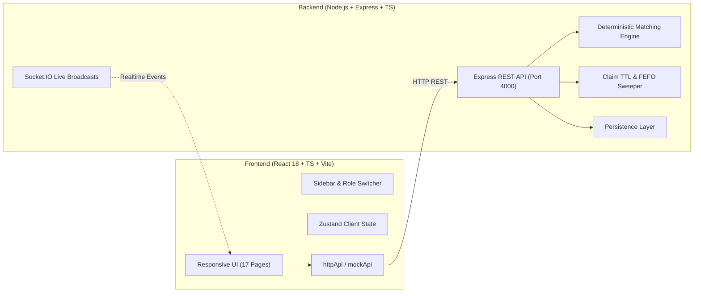

# LastMile Aid — Surplus Food & Aid Coordination Platform

> A responsive, deterministic dispatch and emergency aid coordination platform connecting food donors, volunteer couriers, emergency helpers, and verified shelters.

---

## 🌟 Key Innovations & Business Rules

1. **Deterministic Dispatch Engine**: Partitions large surplus donations (e.g. 180 banquet meals) into delivery batches based on shelter unmet demand, food categories, and courier vehicle capacity.
2. **Strict FEFO Priority (First Expiring, First Out)**: Food nearing its safe consumption window is given elevated matching priority.
3. **Atomic Task Claims & 10-Minute Claim TTL**: Eliminates race conditions with atomic task reservations. If a courier claims a mission but doesn't acknowledge within 10 minutes, the task automatically reverts to the open pool.
4. **Dynamic Reroute Handling**: If a destination shelter reaches capacity (`FULL`), in-flight couriers are automatically offered alternative compatible shelters with **+15 bonus credits**.
5. **Idempotent Impact Credits**: Uniquely keyed by `(eventType, subjectId, userId)` so repeat verifications never issue duplicate points.
6. **Decentralized Open Gate**: Community walk-up distribution listings with digital QR collection tokens when courier capacity is constrained.

---

## 🏗 System Architecture



---

## 🚀 Quick Start Guide

### 1. Prerequisites
- Node.js (v18+)
- npm

### 2. Run the Full Stack

#### Backend Server (Express + Socket.IO + Workers)
```bash
cd backend
npm install
npm run db:seed    # Seeds demo banquet donation, 4 couriers, 4 shelters
npm run dev        # Runs on http://localhost:4000
```

#### Frontend Web Application (React + Vite)
```bash
cd frontend
npm install
npm run dev        # Runs on http://localhost:3000
```

Open **`http://localhost:3000`** in your browser.

---

## 👥 Demo Profiles (1-Click Switch from Top Banner or /login)

| Role | Demo User | Persona & Key Flow |
|---|---|---|
| **Donor** | `donor@lastmile.org` | Posts 60 catering meals using the 4-step wizard; inspects automated batch splits. |
| **Volunteer Courier** | `rider@lastmile.org` | Sets capacity (60 meals), claims task, progresses delivery (`Pickup` ➔ `Deliver`). |
| **Shelter Operator** | `shelter@lastmile.org` | Edits meal demand, manages capabilities, confirms receipt to award courier credits. |
| **Emergency Helper** | `helper@lastmile.org` | Activates proximity radar (3 km), accepts walking legs & unloading tasks. |
| **Admin Dispatcher** | `admin@lastmile.org` | Uses 3-column Mission Control to inject faults (simulate courier dropout, shelter full). |

---

## 🧪 Simulation & Fault Injection Center (`/admin/console`)

The Admin Simulation Console allows judges to test real-time failure recovery:
- **Trigger Matching Engine**: Re-runs greedy allocation across open donations.
- **Expire Claim TTLs**: Forces the 10-minute timeout to return inactive claims to the pool.
- **Simulate Rider Dropout**: Marks a courier unresponsive; their claimed task is immediately re-dispatched.
- **Simulate Shelter Capacity Full**: Marks destination shelter `FULL`; in-transit couriers receive automated reroute proposals with bonus credits.
- **Reset Seed State**: Restores the database back to fresh demo condition.

---

## 📦 Tech Stack

- **Frontend**: React 18, TypeScript, Vite, Tailwind CSS tokens, Lucide Icons, React Router v6, Zustand.
- **Backend**: Node.js, Express, TypeScript, Socket.IO, Prisma-compatible persistence engine, background workers.
- **Quality**: 0 TypeScript compilation errors (`tsc --noEmit`), production bundle compiles in 1.5s.
